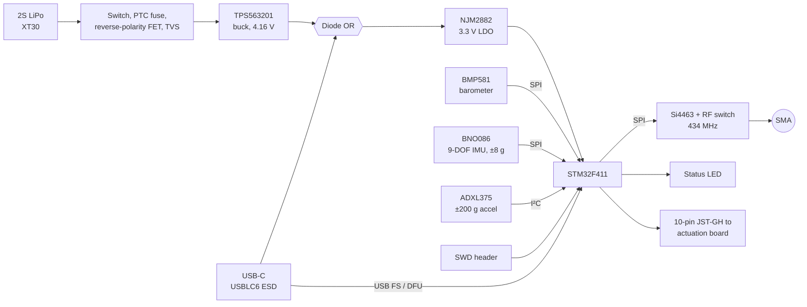
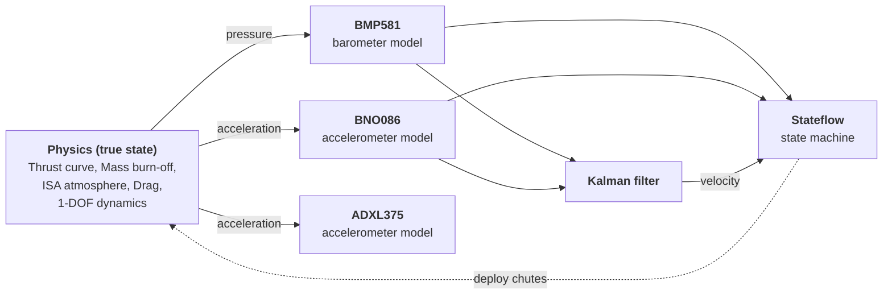
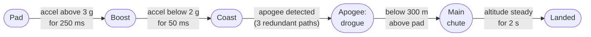

# Icarus Flight Computer
This is a Flight Controller PCB designed in KiCad and simulated in Simulink. It is built around the STM32F411 chip and the Si4463 using the AN648 reference. It has 4 layers, 115 components with power front end, bucks, LDOs, and multiple sensors.

## Hardware

| Function | Part | What it does |
| --- | --- | --- |
| Microcontroller | STM32F411 | Has enough speed for sensor fusion at 100 Hz and enough memory to hold flight data |
| Barometer | BMP581 | 0.25 Pa RMS noise at x16 oversampling (~2cm) at up to 80 Hz |
| IMU | BNO086 | Onboard sensor fusion for orientation and low-noise acceleration when below 8 g |
| High-g Accelerometer | ADXL375 | ±200 g range covers boost and parachute acceleration that saturates the IMU |
| Telemetry | Si4463 | Wireless communication for telemetry and commands |
| USB Protection | USBLC6 | ESD protection on USB-C data lines |
| Buck Converter | TPS563201 | Voltage drop down to 4.16 V (Just in case USB-C also plugged in) |
| Low-Dropout Regulator | NJM2882F33-TE1 | Voltage drop down from 5 V (or 4.16 V) to 3.3 V |
| RF TX/RX Switch | CG2179M2-C4 | Switches between Transmit and Receive to avoid trace noise |

<i>Image taken from KiCad</i>

There are separate I/O pins for pyro channels and servos from the flight controller.

| Board Details | Specifications |
| --- | --- |
| Dimensions | 68.5 x 47 mm |
| Layer Count | 4 Layers |
| Battery Power Input | 2S LiPo XT30 Connector |
| Cable Power Input | USB-C |

### Sensor choices
Initial calculations (before the Simulink design) had shown that we would need to prepare for atleast 10 g worth of force on the sensors. The BNO086 saturates at 8 g so it was decided that implementing a second, high-g accelerometer would be best.

That is why the board carries the ADXL375 alongside the BNO086. With the accuracy from the BNO086 and the high-g sensing from the ADXL375 creates a way to have consistent telemetry from beginning to end.

This is true acceleration:

This is what the ADXL375 sensor sees:

Lastly, this is what the BNO086 sensor sees:

From the graphs (disregarding the offset/bias), the BNO086 has lesser noise than the ADXL375 (at some points the ADXL may reach around ±1 m/s2 of noise), but the BNO086 saturates at high peaks. Therefore both sensors are needed for a full measurement.

## Flight Simulation (Simulink)

The model keeps physics, sensors, and flight software strictly separate. The flight computer logic only ever sees sensor outputs and never the true state. Meaning the simulation only uses the same information the board should have.

### Sensor models

Each sensor in Simulink reproduces the datasheet behavior for sample rate, noise, bias, range limit, and resolution.

| Sensor | Rate | Noise | Bias | Range / Resolution |
| --- | --- | --- | --- | --- |
| BMP581 (x16 OSR) | 80 Hz | 0.25 Pa RMS | ±75 Pa Absolute Pressure | N/A |
| BNO086 | 500 Hz | 0.3 m/s2 | 0 to ±0.5 m/s2 | ±8 g, 1/256 m/s2 (Q8) |
| ADXL375 | 800 Hz | 5 mg√Hz (~100 mg RMS) | 400 mg | ±200 g, 49 mg/LSB |

### Flight state machine

+ Pad calibration is conducted while on the pad. The flight computer averages the barometer to find ground level and uses that as a reference for the rest of the flight. This cancels the sensor's absolute offset.
+ There are redundant apogee detection in order to avoid misfires that occurred during simulation. All 3 paths also require the rocke to be at least 100 m above the pad, so no parachute can fire on the ground.
  + Normal: The barometer has dropped 1 m below its peak AND thhe Kalman-filtered velocity has turned negative.
  + Timeout: Either check has held for 1 s by itself.
  + Backup Timer: A fixed time after burnout that is independent of the barometer.
+ The Kalman filter fuses the barometer altitude with the accelerometer data to estimate altitude and velocity. Velocity noise is about ±0.25 m/s which is roughly 10x better than differentiating the barometer directly.

### Kalman Filter

The filter tuned directly from datasheet noise with measurement noise R = (barometer noise in meters)2 which is around 2 cm2, and process noise Q from the BNO086's (0.3 m/s2)2 acceleration variance. It keeps this tuning even when the stress test raises the noise by 30x.

The Kalman filter significantly improves the measurement reliability of height and velocity.

Height:

Velocity:

Velocity is measured by integrating acceleration so there are issues that the Kalman filter catches such as during landing, acceleration is at a constant 9.81 but velocity should be zero

There is still issues with the Kalman filter. For example, there is a startup transient issue at the beginning due to how h_avgStart is measured so there is a wind up at the beginning before the filter is actually accurate.

Height:

Velocity:

Regardless, the measurements are more accurate than just using the barometer (brown).

With a combination between the Kalman filter, the IMU, and the high-g accelerometer, we are able to get a reasonably accurate sensor fusion setup for what we need to operate the flight controller.

## Graphs and Simulation Results
Tests were conducted with 100 randomized flights. Tests were conducted up to the datasheet worse cases, and go well beyond them for barometer noise due to how important the barometer is and how much noise is to be expected in the rocket.

| Check | Results |
| --- | --- |
| How many flights pass | 100 / 100 |
| Drogue deployment after true apogee | 0.10 to 0.53s |
| Rocket speed at drogue | under 5 m/s |
| Main deployment altitude error | 1 to 2 m |
| Pad Bumps | Up to 40 g for 100 ms |
| Peak Acceleration | 17 g |

### Stress Testing

The model was tested 100 times and each flight has different values for every error source below. The Kalman filter keeps its nominal datasheet tuning (meaning the weights are never adjusted in order to keep things close to the real world).

| Randomized Parameter | Range |
| --- | --- |
| Barometer Offset | ±75 Pa |
| Barometer Noise | 1x - 30x datasheet values (airflow and port effects) |
| BNO086 Bias/Noise | ±0.5 m/s2 / 1x - 5x |
| Motor Total Impulse | ±10% |
| Drag Coefficient | 0.40 - 0.60 |
| Dry Mass | ±5% |
| Time on the Pad | 2 - 6s |
| Pad Bump | 5 - 40 g, 1 to 100 ms |

A passing flight passes only if:
+ There is no false launch
+ The drogue fires after apogee below 15 m/s
+ The main flight_state fires within 25 m of its target altitude
+ Landing is detected within 5 s of touchdown.

### Results: 100 / 100 flights passed

+ Flight Paths: The Apogee varies from about 535 to 755 m with motor, drag, and mass variation. The drogue (red) fires at the peak every time, and the main (blue) at 300 m.

+ Apogee Timing: The drogue fired 0.10 to 0.53 s after true apogee in every flight. It also triggered only after apogee

+ Drogue Speed vs Noise: Deployment speed always stays under 5 m/s even at 30x the datasheet barometer noise.

+ Main Altitude: Main deployment lands about 1 to 2 m below 300 m regardless of barometer offset. The pad calibration removes the offset completely so the consistent shortfall from the distance fallen during the 50 ms value hold.

+ Pad Bumps: Every pad bump up to 40 g and 100 ms was safely rejected. The actual launch  must sustain over 3 g for 250 ms which is a 2.5x margin over the longest bump tested.

### Design changes from the stress test

Originally, all flight states used a 50 ms value check, including the pad flight state. This caused an issue with the flight logic where some flights fired the parachute on the pad from bumps or otherwise. Thus led to a separate 250 ms value check. The initial launch from the pad to the end of burn is around 1.8 seconds so the 250 ms check is fine.

The other issue was missing landings due to high barometer noise. A 1 m change tolerance was smaller than the noise spikes at 20 to 30x. So the tolerance was sized to the noise (3 m) with a 2 s value hold.

Lastly, to avoid misfires of the parachute, a 100 m arming altitude was also added to every apogee path as a second layer of protection in the Stateflow system.

## Limitations
+ 1-DOF: The calculations only work on the second dimension. Meaning theres no window, attitude, or weathercocking.
+ Instant Braking: The braking/parachuting is instant so it takes into account the best case scenario.

## Future Steps
+ Implement 2-DOF simulation
+ Implement delayed braking
+ Signal Integrity Analysis

